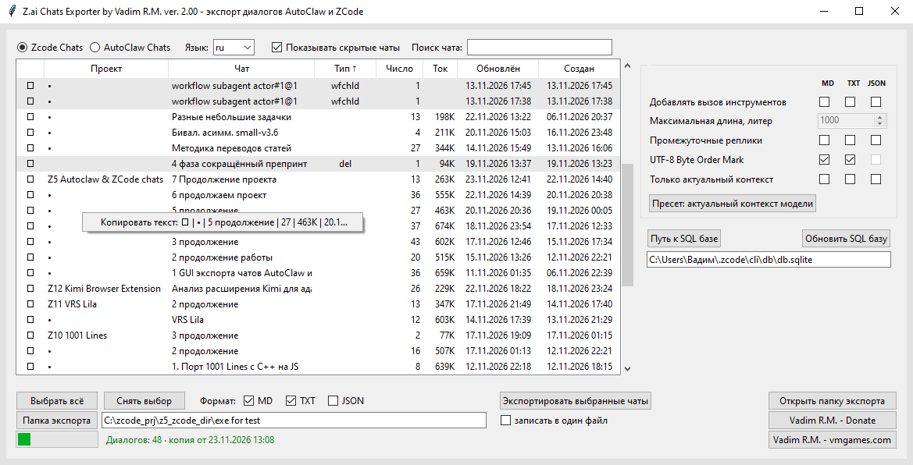

# Z.ai Chats Exporter — 界面详细说明（ver. 2.00）

中文 · [English](MANUAL.md) · [Русский](MANUAL.ru.md)

本文是 [README.zh.md](README.zh.md) 的补充：窗口的每个元素、状态、配置文件及其行为细节。若与程序不一致，以程序为准。

## 1. 总览

- 单个 exe（`ExportChat.exe`），完全便携：设置、语言文件和数据库本地副本都在 exe 旁；不使用注册表和 %APPDATA%。
- 源 AutoClaw/ZCode 数据库从不被修改：程序使用自己的副本（SQLite backup API，`mode=ro` 只读）。
- 重复启动不会开出第二个窗口：已有窗口被带到前台。
- 最低系统：Windows 8.1（64 位）。

## 2. 窗口标题

「Z.ai Chats Exporter by Vadim R.M. ver. N.NN — …」。图标为「羽毛笔」（exe 图标与窗口一致）。右键点击窗口空白处可复制完整标题。

## 3. 模式与聊天列表

- 单选按钮 **Zcode Chats** / **AutoClaw Chats**（Zcode 在左；首次启动进入 Zcode；之后记住上次模式）。切换模式会更换列表、数据库路径和选项矩阵中行的可见性。
- 复选框**「显示隐藏的聊天」**：显示默认隐藏的对话。「类型」列给出原因：`del` — 已删除、`arch` — 归档、`wfchld` — workflow 子会话、`selchat` — 上下文副本（side-chat）、`auto` — 服务对话；空（「—」）— 普通可见聊天。
- **搜索** — 按聊天标题过滤（不区分大小写）。
- 表格列：☑、「项目」「聊天」「类型」「数量」（请求/回答）、「Token」（最后请求的上下文大小）、「更新」「创建」。点击表头升/降序排序。默认勾选第一个聊天。
- **右键点击行** —「复制文本：…」复制**光标处**的行（所有列以「 | 」连接），与蓝色选中无关。
- **右键点击表头** — 两个菜单项：复制所有列标题；「复制表头和聊天列表」（表头 + 当前过滤显示的全部聊天；隐藏的不含）。

## 4. 数据库：路径、本地副本、刷新

- **「SQL 数据库路径」**字段 + 按钮：选择主文件（AutoClaw 为 `runtime.sqlite`，ZCode 为 `db.sqlite`）。对话框在合理的文件夹中打开：配置路径存在则用其文件夹，否则用 exe 文件夹。
- 程序使用主文件的**本地副本**（exe 旁的 ZCodeData / AutoClawData）。副本不存在时启动会询问「缺少本地数据副本，是否导入？」并复制主文件；主文件不存在则给出带提示的诚实状态。
- 按钮**「刷新 SQL 数据库」** — 安全导入：主文件先复制到临时文件并校验表结构，然后旧副本轮换进备份（`.bak1`–`.bak3`，三个历史版本），新副本就位。失败时回滚到 `.bak1`；垃圾文件不会碰本地副本。
- 复制通过 SQLite backup API 进行 — **无需关闭 AutoClaw/ZCode**。「主文件 = 本地副本」的情况会被状态拒绝（以前可能损坏数据库）。
- ZCode 还会复制第二个数据库 `tasks-index.sqlite`（项目名称所需）；按配置找不到时先在主文件旁查找；仍失败则导入为「最小组成」并出现黄色提示。
- 导入状态：绿色「副本已导入」、黄色「最小组成…」、出错为红色。

## 5. 导出文件夹

- **「导出文件夹」**字段 +「选择…」— 母文件夹；聊天写入「ZCode Chats」/「AutoClaw Chats」子文件夹，其中再按项目分夹（ZCode）。
- 按钮**「打开导出文件夹」**在资源管理器中打开；导出后会选中最后一个文件。路径不存在（或是文件）— 红色状态**「导出文件夹无效」**；通过「选择…」选定正确文件夹后错误自动清除。
- 文件从不被覆盖：重复导出同一聊天会加后缀 ` (1)`、` (2)`…

## 6. 格式与选项矩阵

**MD / TXT / JSON** 复选框选择格式；选项矩阵按格式分别配置：

- **「添加工具调用」** — `🔧 名称 — 状态` 区块（JSON 调用和结果）；共用的**「结果最大长度（字符）」**限制同时裁剪调用与结果。
- **「中间回复」** — 工具调用之间 AI 的推理/进度文本。
- **「显示服务文件」**（仅 AutoClaw）—「其他文件：」区块（过程中创建的脚本和草稿）；已交付文件（「可下载：」区块）和用户附件始终显示。
- **「UTF-8 Byte Order Mark」** — `.md`/`.txt` 的 BOM（旧版记事本需要）；JSON 中该格为灰色 — 不可能有 BOM。
- **「仅当前上下文」**（仅 ZCode）— 模型**现在**看到的切片：最后一次自动压缩之前的内容被机器摘要（「压缩历史的摘要」）取代，保留存活尾部；包含 GUI 中不可见但存在于上下文中的服务消息。普通模式下只标记压缩边界。
- 按钮预设**「预设：模型的当前上下文」** — 一键：当前上下文开、工具开、回复关、限制 10000（ZCode 的硬上限）。
- 复选框**「写入一个文件」** — 所有选中聊天按每个格式打包为一个文件（`AC-ALL-…` / `ZC-ALL-…`）；「全选」+ 复选框 = 整个模式一个文件。空聊天也包含（仅头部）。

## 7. 状态栏

- 颜色：绿 — 成功/信息，黄 — 警告，红 — 错误。示例：「对话数：48 · 副本自 2026-11-23 13:08」、「正在加载聊天列表…」、「完成：N 个文件，M 个错误」。
- 黄色提示：「找不到/损坏 db_profiles.cfg — 已写入出厂文件」、「文件中的字符串过长：(名称)」（配置/语言文件超过 500 字符的字符串被截断）、无第二数据库导入后的「最小组成」提示。提示立即显示，列表加载后不再重复。
- 状态文本可用 Ctrl+C 或右键复制；空状态复制窗口标题。

## 8. 文本复制（右键）

- **输入框**（数据库路径、文件夹、搜索、限制）：复制/粘贴/剪切/全选；无选中时复制/剪切**整个**文本。
- **任意界面元素**（按钮、复选框、标签）：「复制文本：…」。
- **表格行** — 点击处；**表头** — 所有列（+「表头和聊天列表」）；**窗口空白处** — 窗口标题；**状态栏** — 其文本。
- 自绘对话框（询问、警告、错误）：文本在可选择的小组件中 — 鼠标选择、Ctrl+C、右键。

## 9. 语言

ru/en/zh 切换改变界面和导出文件中的标签语言。全部字符串在 exe 旁的 `lang_ru.cfg`、`lang_en.cfg`、`lang_zh.cfg`：文本编辑即可，每次切换语言时重读；文件损坏 — 警告并使用内置字符串。超过 500 字符的字符串被截断并给出黄色提示。

## 10. 配置文件

- **`ExportChat.cfg`**（v7，UTF-8 BOM，JSON）— 界面设置：语言、文件夹、主路径、选项矩阵、限制、窗口几何、模式。首次启动创建；旧版本（v6 及以上）自动迁移；外来结构 — 文件保留为 `.err` 并创建出厂配置。
- **`db_profiles.cfg`**（v3，UTF-8 BOM，带提示的 JSON）— 数据库标准名称与路径、每个数据库的文件清单（相对主文件，含 wal/shm 和 ZCode 第二数据库）、`_version` 标记。人工可编辑：应用换了数据库位置 — 改文本即可，无需动 exe。缺失 — 创建出厂文件（黄色提示）；损坏 — `.err` + 出厂文件。
- **`lang_*.cfg`** — 见第 9 节。

## 11. 导出的文件

- 名称：`AC-YYYY-MM-DD 标题.ext` / `ZC-YYYY-MM-DD 标题.ext`。
- **头部**（md/txt/json）：「内核：ZCode 0.17.1」（ZCode 内置内核版本，非应用版本）或「框架：AutoClaw」；项目；聊天；类型；会话；目录（ZCode）；创建/更新；**消息：N / M（问题/回答）**；文件（附件/可下载）；模型（ZCode 带 effort）；**聊天上下文：28 019 token（2.8%/1M）** — AutoClaw 风格为「16 161 из 1М (1.5%)」加「自动压缩阈值：812 К (77%)」；累计消耗；导出时间；导出器签名行（txt 中带虚线框，每个聊天后还有页脚）。
- **正文**：回合「### N. 你 — 日期」→ 请求文本 →「📎 附件：」（始终）→ 工具 → 带作者的回答（「GLM-5.3 Max — 日期 (3 分 58 秒)」）；AutoClaw 在回答后 —「📄 可下载：」，选项开启时还有「其他文件：」。
- **TXT**：标记解析为纯文本，代码变为「python { … }」区块，标题下加横线。
- **JSON**：`session`（同一头部）+ `turns[]`（`request/attachments/answers/tools/narration`）。

## 12. 已删除的聊天：实用场景

1. **刚删除、程序还开着** — 不关闭 ZCode/AutoClaw 直接启动导出器：本地数据库副本里该聊天仍是「活的」，像普通聊天一样出现在列表中。
2. **副本已刷新、聊天消失** — 勾选「显示隐藏的聊天」：数据库中聊天通常保留删除标记，以 `del` 类型显示；可像普通聊天一样导出。
3. **删除已久、副本刷新过多次** — 机会较小：打开 exe 旁的 `ZCodeData`（`AutoClawData`）文件夹，那里保存三个历史版本（`.bak1` 为其中最新）。关闭导出器，把当前 `db.sqlite`（`runtime.sqlite`）改名，把 `.bak1` 改回原名 — 聊天重新出现在列表中（隐藏、`del`）。因此建议每个工作日结束时刷新副本：相当于口袋里装着三天的备份。

## 13. 已知特点

- 数据库结构为内部格式：AutoClaw/ZCode 大版本更新后程序可能报告未知结构 — 它不会损坏数据，配置用文本编辑即可修复。
- 「Token」列：ZCode 为最后一次请求的大小（整个上下文）；AutoClaw 为最后一个完成回合的上下文。
- 上下文占比（X%/1M）仅对已知模型（GLM-5.3 / GLM-5.3-Flash）显示；其他模型只给 token 数。
- 开启工具调用的「一个文件」导出可能非常大。
- ZCode 项目名称来自 `tasks-index.sqlite`；没有它时聊天不按名称分组。
